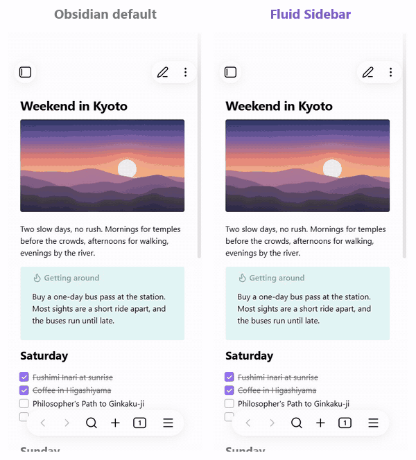
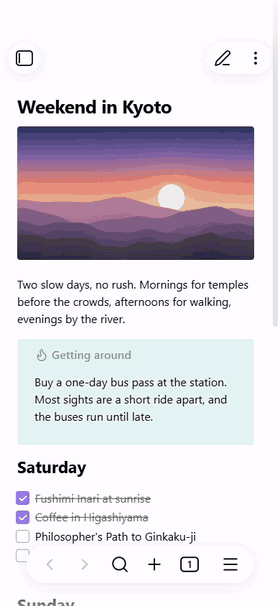
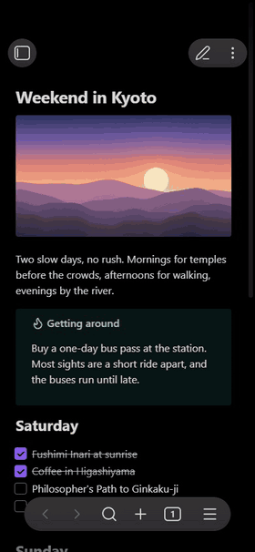

# Fluid Sidebar

*[中文说明](README.zh-CN.md)*

**A native-feeling sidebar animation for Obsidian mobile (iPhone and Android).** When you swipe a sidebar open, the note you were reading shrinks into a rounded, dimmed card and slides aside, and the sidebar glides in underneath it. The card follows your finger, springs on release and gives a light haptic tick. Tap the card or swipe it back to return.

It is not a theme: it works with any theme and doesn't change your colours or fonts. It only changes how the sidebar moves.

  

The same swipes, side by side: Obsidian's default sidebar on the left, Fluid Sidebar on the right.

## Why

On a phone you open the sidebar all the time: to switch notes, browse folders, check the outline or backlinks. In Obsidian mobile that movement is flat: the sidebar simply slides over, with no depth and no feedback. Fluid Sidebar replaces it with a more modern, more designed card-style transition: the note is pushed aside as a card and the sidebar is revealed underneath, so moving between your notes and the file list feels smooth and physical instead of mechanical.

## What it does

- **Follows your finger.** The card tracks the swipe exactly while your finger is down.
- **Springs on release.** After you let go, the card finishes on a spring that carries the speed of your flick, instead of a fixed-length animation.
- **Card look.** The main view gets rounded corners, a soft shadow, a slight shrink and a dark overlay as it moves away. The sidebar slides in with a small parallax.
- **Haptic feedback.** A light tick when the card crosses the halfway point, on phones that support it.
- **Both sidebars.** Works for the left and the right sidebar.
- **No settings.** Install it and swipe.

Obsidian still decides when a swipe opens or closes a sidebar. Fluid Sidebar only changes how the movement looks, so your gestures work the same as before.

### In light and dark mode

  
  &nbsp;
  

## Requirements

- **Obsidian on a phone** (iPhone or Android), version 1.11 or later. On iPad, tablets and desktop the plugin does nothing.
- **Sliding sidebar** turned on in Settings → Appearance. It is on by default on phones; with it off, the plugin does nothing.

## Installation

In Obsidian on your phone, open **Settings → Community plugins → Browse**, search for **Fluid Sidebar**, install it and turn it on. If you sync your vault, you can also install it on desktop: it stays inactive there and switches on by itself on your phone.

## Compatibility

Tested on iPhone at 60 Hz and 120 Hz, in light and dark mode, with:

- the default theme and Minimal
- Excalidraw, Kanban and Notebook Navigator
- canvas, Bases, PDF, image and video files (including a video that is playing)

Notebook Navigator uses a swipe-right gesture to go back to the folder list. That is no problem when it sits in the left sidebar, which is its default; if you move it to the right sidebar the two swipes can overlap.

## FAQ

**How do I make the Obsidian mobile sidebar smoother or nicer to use?**
Install Fluid Sidebar. It replaces the flat slide of the left and right sidebars on your phone with a finger-following, spring-based card animation with haptic feedback. Your file explorer, Notebook Navigator, outline, backlinks or any other sidebar view stays the same; only the transition changes.

**Can I get an iOS-style sidebar (push-away drawer) in Obsidian?**
Yes, that is exactly what this plugin does on iPhone and Android phones: the note is pushed aside as a card and the sidebar is revealed underneath, like the side menus in many native iOS apps.

**Does it work on iPad or desktop?**
No. It is made for phone screens, where the sidebar slides over the note. On iPad, tablets and desktop it stays inactive.

**Does it work on Android?**
It uses the same Obsidian mobile sidebar on Android, so it should work the same way, but it has been tested most on iPhone. Please open an issue if anything looks wrong.

**Will it change my theme?**
No. The only colour it adds is a slightly darker shade of your theme's own sidebar colour, so the card stands out. Everything else is your theme.

**Does it slow Obsidian down?**
It only works while a sidebar is moving or open, and then it moves just the note, the sidebar and the navigation bar. When the sidebars are closed it does nothing.

**What if an Obsidian update breaks it?**
Fluid Sidebar checks the parts of Obsidian it relies on before it does anything. If an update changes them, or anything throws an error, the plugin steps aside: the sidebar goes back to Obsidian's normal behaviour and a notice tells you. Restarting Obsidian tries again. The worst case is the default look, never a broken layout.

**Does it collect any data?**
No. It makes no network requests and stores nothing.

## License

[MIT](LICENSE)
