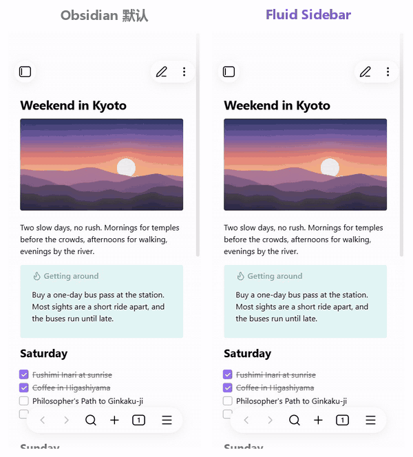
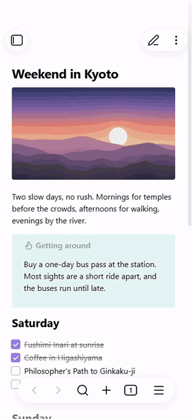
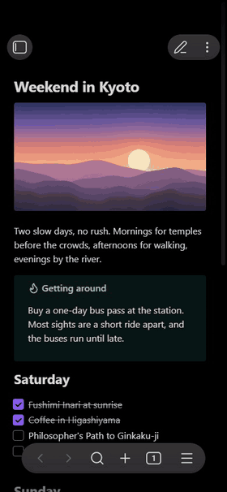

# Fluid Sidebar

*[English](README.md)*

**让 Obsidian 手机版（iPhone 和安卓）的侧边栏像原生 App 一样顺滑。** 滑开侧边栏时，正在看的笔记会缩成一张带圆角、变暗的卡片推到一边，侧边栏从它下面滑进来。卡片跟着手指走，松手有弹性，还会轻轻震一下。点一下卡片或者把它滑回去，就回到笔记。

它不是主题：和任何主题都兼容，不改你的配色和字体，只改侧边栏推拉时的手感。

  

同样的几下滑动，左右对比：左边是 Obsidian 默认的侧边栏，右边是开启 Fluid Sidebar 后。

## 为什么做它

在手机上，侧边栏是用得最频繁的地方之一：切换笔记、翻文件夹、看大纲和反向链接。但 Obsidian 手机版的侧边栏推拉很平：侧边栏直接盖过来，没有层次，也没有反馈。Fluid Sidebar 把它换成更现代、更有设计感的卡片式过渡：笔记被推开成一张卡片，侧边栏从下面露出来，让你在笔记和文件列表之间来回切换时，手感顺滑、有分量，而不是生硬地切过去。

## 它做了什么

- **跟手**：手指按住时，卡片和手指位置完全一致。
- **松手有弹性**：松手后，卡片按你甩出去的速度用弹簧动画走完，而不是固定时长的动画。
- **卡片样式**：主视图离开时会加上圆角、柔和的阴影、轻微缩小和变暗；侧边栏带一点视差滑入。
- **震动反馈**：卡片经过一半的位置时轻震一下（手机支持时）。
- **左右侧边栏都支持。**
- **没有设置项**：装上就能用。

什么时候打开、什么时候关闭，仍然由 Obsidian 自己判断。Fluid Sidebar 只改变移动的样子，所以手势习惯和原来一样。

### 浅色和深色模式

  
  &nbsp;
  

## 使用条件

- **手机上的 Obsidian**（iPhone 或安卓），1.11 或更新版本。在 iPad、平板和电脑上插件不起作用。
- 「设置 → 外观」里的**滑动侧边栏**（Sliding sidebar）需要开着。手机上默认就是开的；关掉时插件不起作用。

## 安装

在手机上的 Obsidian 里打开「设置 → 第三方插件 → 浏览」，搜索 **Fluid Sidebar**，安装并启用。如果你的库是同步的，也可以在电脑上装：电脑上它不起作用，同步到手机后会自动生效。

## 兼容性

已在 iPhone 上测试过 60 Hz 和 120 Hz、浅色和深色模式，以及：

- 默认主题和 Minimal 主题
- Excalidraw、Kanban、Notebook Navigator
- 画布、Bases、PDF、图片、视频文件（包括正在播放的视频）

Notebook Navigator 用「向右滑」返回文件夹列表。它放在左侧边栏（默认位置）时没有冲突；如果你把它挪到右侧边栏，两个滑动手势可能会互相干扰。

## 常见问题

**怎么让 Obsidian 手机版的侧边栏更顺滑、更好用？**
装上 Fluid Sidebar 就行。它把手机上左右侧边栏生硬的平移，换成跟手、有弹性、带震动反馈的卡片动画。文件列表、Notebook Navigator、大纲、反向链接这些侧边栏里的内容都不变，只改推拉的过渡。

**Obsidian 能做出 iOS 那种侧边栏（把内容推开的抽屉式菜单）吗？**
能，这个插件在 iPhone 和安卓手机上做的就是这件事：笔记被推成一张卡片移到旁边，侧边栏从下面露出来，和很多 iOS 原生 App 的侧边菜单一样。

**iPad 或电脑上能用吗？**
不能。它是为手机屏幕设计的，手机上的侧边栏会盖住笔记。在 iPad、平板和电脑上插件不起作用。

**安卓能用吗？**
安卓用的是同一套 Obsidian 手机版侧边栏，所以应该一样能用，但目前主要在 iPhone 上测试。如果哪里不对，欢迎提 issue。

**会改我的主题吗？**
不会。它唯一加的颜色，是把你主题自己的侧边栏颜色稍微调深一点，好让卡片显出来。其他都是你主题原来的样子。

**会让 Obsidian 变慢吗？**
只有侧边栏在移动或打开时它才工作，而且只移动笔记、侧边栏和底部导航栏。侧边栏关着时它什么都不做。

**Obsidian 更新后坏了怎么办？**
Fluid Sidebar 在起作用前，会先检查它依赖的 Obsidian 部分是否还在。如果更新改变了这些部分，或者运行中出了错，插件会自动退出：侧边栏恢复成 Obsidian 原本的样子，并弹出提示。重启 Obsidian 会再试一次。最坏的情况只是变回原样，不会把界面弄乱。

**会收集数据吗？**
不会。它不联网，也不保存任何东西。

## 许可

[MIT](LICENSE)
